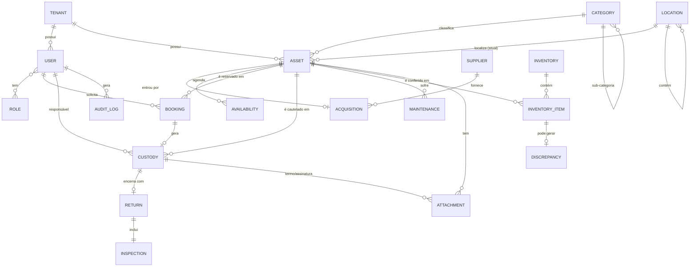

# Entidades e Modelo de Dados ✅

Termos: `dominio/glossario.md`. Invariantes: `dominio/regras-negocio.md`.

## Regras transversais
- **Toda** tabela (exceto `Tenant`) tem `tenant_id` (FK) + índice. Toda query filtra por tenant.
- Campos base em todas: `id` (UUID), `created_at`, `updated_at`, `created_by`, `deleted_at` (soft delete).
- Chaves: UUID v7 (ordenável) como PK.
- Dinheiro: `DECIMAL(14,2)`, nunca float. Datas com timezone.

## Diagrama de Entidade-Relacionamento

## Dicionário de campos (essenciais)

### Asset (Bem) — Art.30 a, c
| Campo | Tipo | Notas |
|---|---|---|
| `asset_tag` | string, único por tenant | numeração patrimonial (`PAT-{ano}-{seq}`) |
| `name`, `description` | string / text | |
| `category_id` | FK Category | |
| `location_id` | FK Location | local **atual** |
| `acquisition_id` | FK Acquisition | origem (compra/doação) |
| `condition` | enum | novo/bom/regular/ruim/inservível |
| `status` | enum | disponível/reservado/em_uso/manutenção/baixado |
| `acquisition_value` | decimal | valor de entrada |
| `current_value` | decimal | valor depreciado (calculado) |
| `protection_notes` | text | acondicionamento/proteção — Art.30 c |
| `is_bookable` | bool | participa da agenda? |

### AssetLabel (Etiqueta) — Art.30 a
`asset_id`, `type` (qr/barcode), `payload` (URL/código), `printed_at`.

### Location (Localização hierárquica)
`parent_id` (self-FK), `name`, `type` (unidade/prédio/andar/sala), `path` (materialized path p/ busca).

### Acquisition (Aquisição) — Art.30 a
`type` (compra/doação), `supplier_id` (nullable p/ doação), `document_ref` (NF/termo), `date`, `value`.

### Availability + Booking (Agenda) — estilo Booksy
- **Availability**: `asset_id`, `weekday`/`date`, `start`, `end`, `slot_minutes`.
- **Booking**: `asset_id`, `requester_id`, `start_at`, `end_at`, `status` (pendente/aprovada/recusada/cancelada/concluída), `approver_id`.
- Invariante: **sem sobreposição** de bookings aprovadas para o mesmo `asset_id`. Ver `regras-negocio.md`.

### Custody (Cautela) — Art.30 d ⭐
| Campo | Tipo | Notas |
|---|---|---|
| `asset_id` | FK Asset | |
| `booking_id` | FK Booking (nullable) | origem, se veio de reserva |
| `holder_id` | FK User | associado responsável |
| `issued_by` | FK User | Diretor Patrimonial |
| `issued_at` | datetime | entrega |
| `due_at` | datetime | prazo previsto de devolução |
| `condition_out` | enum | estado na entrega |
| `term_id` | FK Attachment | PDF do termo |
| `signature_holder` | signature | assinatura do associado |
| `signature_issuer` | signature | assinatura do diretor |
| `status` | enum | ativa / devolvida / atrasada / extraviada |

### Return + Inspection (Devolução + Inspeção) — Art.30 d
- **Return**: `custody_id`, `returned_at`, `received_by`.
- **Inspection**: `return_id`, `condition_in`, `has_damage` (bool), `notes`, `photos` (attachments), `outcome` (ok/dano/faltante).

### Inventory + InventoryItem — Art.30 b
- **Inventory**: `title`, `scope` (location_id / category_id / todos), `period_start`, `period_end`, `status` (aberto/em_andamento/fechado), `responsible_id`.
- **InventoryItem**: `inventory_id`, `asset_id`, `expected_location_id`, `found_location_id`, `found` (bool), `condition_found`, `scanned_at`, `scanned_by`.
- **Discrepancy**: `inventory_item_id`, `type` (não_encontrado/local_divergente/estado_divergente/não_cadastrado), `resolved` (bool).

### Maintenance — Art.30 c
`asset_id`, `type` (preventiva/corretiva/proteção), `opened_at`, `closed_at`, `cost`, `provider`, `status`.

### AuditLog (imutável)
`actor_id`, `action`, `entity_type`, `entity_id`, `diff` (jsonb), `ip`, `at`. Append-only, sem update/delete.
