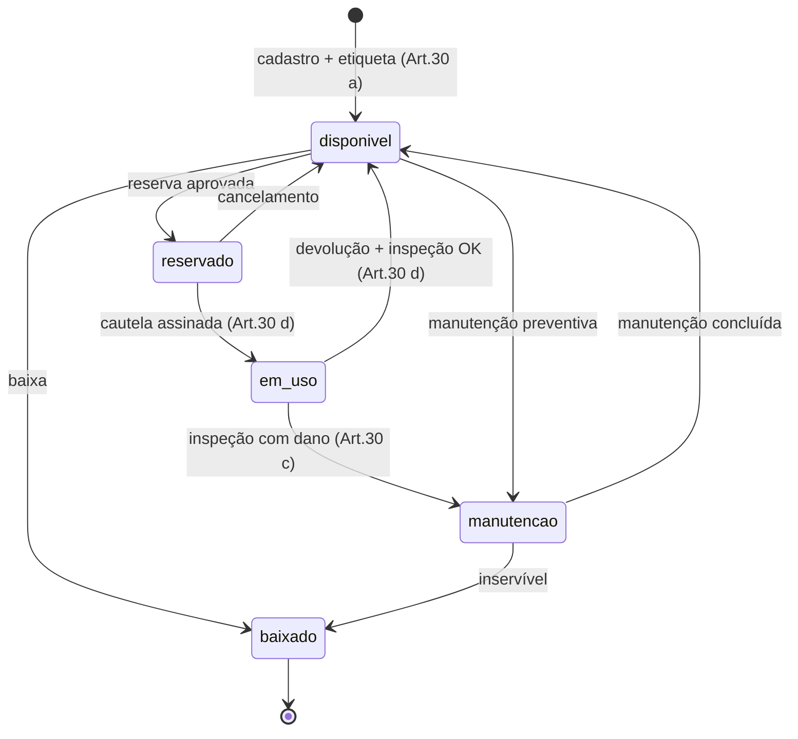
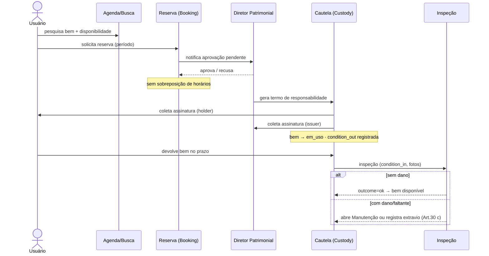
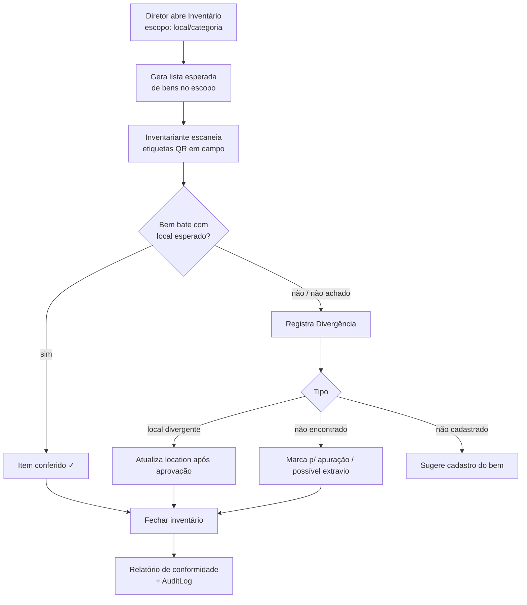
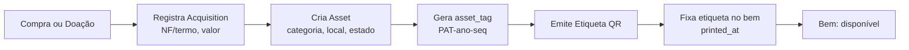

# Fluxos de Negócio ✅

## 1. Ciclo de vida do Bem (máquina de estados)

## 2. Fluxo principal: Pesquisar → Cautela → Inspeção (Art.30 d) ⭐

**Invariantes deste fluxo** (ver `regras-negocio.md`):
- Cautela só existe com **as duas assinaturas** (associado + diretor).
- `condition_out` é obrigatório na entrega; `condition_in` obrigatório na devolução — a comparação alimenta a inspeção.
- Bem não pode ser cautelado se `status != reservado/disponível`.
- Prazo vencido (`due_at < now` e `status=ativa`) → cautela vira `atrasada` (job Celery) e notifica.

## 3. Inventário periódico (Art.30 b)

## 4. Aquisição e catalogação (Art.30 a)

## Notas de implementação
- Diagramas Mermaid renderizam no GitHub e em artifacts. Mantenha-os atualizados junto com o código.
- Cada fluxo acima tem casos de uso detalhados no `modulos/<nome>.md` correspondente.
